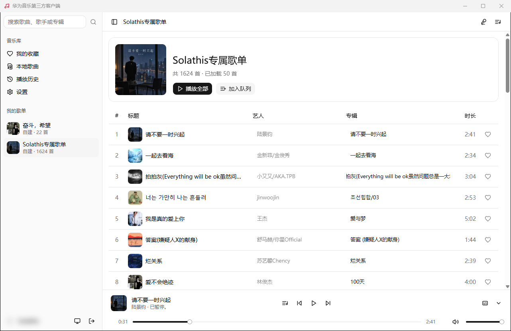
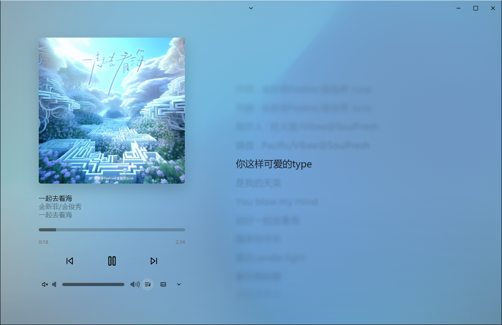
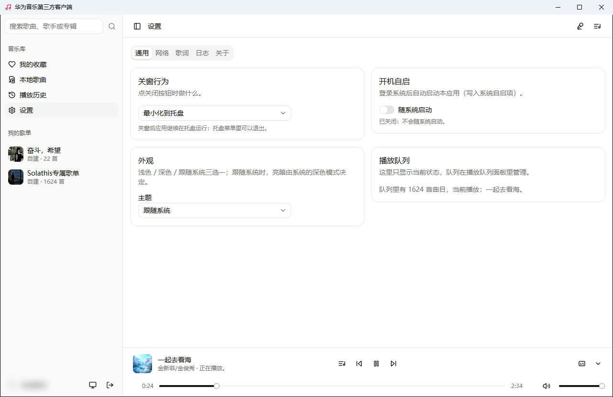
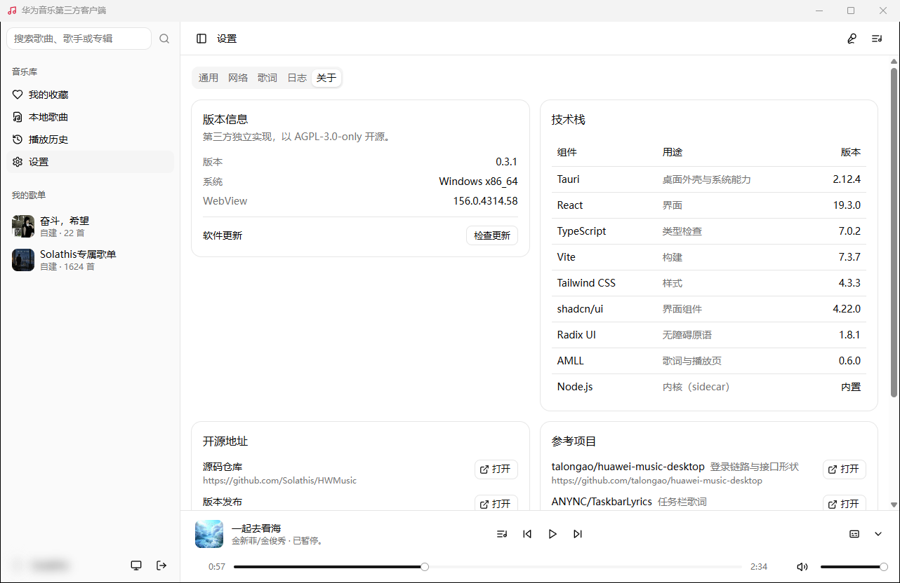

# HWMusic · 华为音乐第三方桌面客户端

基于 Tauri 2 + React 的华为音乐 Windows 客户端：扫码登录、音乐库与播放、AMLL 歌词、桌面歌词与任务栏歌词、在线更新。

源码：https://github.com/Solathis/HWMusic

## 下载

- 只在 [GitHub Releases](https://github.com/Solathis/HWMusic/releases) 发布：下载 `HWMusic_<版本>_x64-setup.exe` 与 `SHA256SUMS`。
- 核对哈希：`certutil -hashfile HWMusic_<版本>_x64-setup.exe SHA256`，与 `SHA256SUMS` 一致再安装。
- 安装包未签名，SmartScreen 拦下时选「更多信息」→「仍要运行」。
- 0.3.0 起可在「设置 → 关于」检查更新并在线安装；0.2.0 需要手动安装一次 0.3.0。
- 只在 Windows x64 上构建和验证过。

## 截图

实机截图（Windows x64，账号区已打码）：









## 资源占用

以下为 Windows x64 实机测得（整棵进程树：应用主进程 + 内核 sidecar + WebView2 渲染进程）：

| 场景 | 工作集 | 私有内存 |
|---|---|---|
| 播放中（含封面与歌词） | 约 640 MB | 约 380 MB |
| 暂停 / 空闲（停在设置页） | 约 645 MB | 约 390 MB |

拆分：主进程约 42 MB、内核约 65 MB，其余约 530 MB 是 WebView2（Chromium 多进程：界面、渲染、GPU、网络）。数字随播放、歌词动画与系统缓存波动，任务管理器里看到的 `msedgewebview2.exe` 也属于本应用。

## 功能

- **登录**：扫码登录（显示剩余有效时间，过期点击刷新），也可打开官方网页登录；登录态用 Windows DPAPI 加密保存在本机。
- **音乐库**：收藏、我的歌单、搜索、专辑、歌手、播放历史、本地歌曲；整表播放或加入队列，列表触底加载。
- **播放**：播放队列、播放模式与音量；启动时恢复上次的歌曲与进度。
- **歌词**：AMLL 渲染，逐字高亮与翻译行；沉浸式歌词页；缓存 90 天，可导入本地 `.lrc` / `.txt`。
- **桌面歌词**：横版与竖排、锁定后鼠标穿透、样式在气泡面板里设置；任务栏歌词（Beta）。
- **系统集成**：托盘、全局快捷键、单实例、开机自启、浅色 / 深色 / 跟随系统主题、HTTP 代理（不使用 / 系统代理 / 自定义，可只用于检查更新）、运行日志。
- **关于与更新**：版本、技术栈与开源地址；检查更新、下载验签后安装并重启。
- **不做**：每日推荐、移动端、云同步、其它平台音源、绕过付费或 DRM、加入已有歌单（还没有官方追加接口的证据）。

## 从源码构建

需要 Node.js ≥ 22.18.0、Rust stable（`x86_64-pc-windows-msvc`）与 MSVC Build Tools。

```powershell
npm ci
npm run dev                 # 开发：vite + tauri
npm run typecheck
npm run build:web
npm run test:browser        # 真 Chromium 的界面守卫（先 build:web 与 dist:sidecar）
npm run dist:win            # 打包 NSIS 安装包
npm run check:nsis
npm run release:checksums
npm run release:assets      # 英文名安装包、SHA256SUMS、latest.json、RELEASE_NOTES.md
```

每个版本的更新内容见 [CHANGELOG.md](CHANGELOG.md)。

## 参考项目

| 项目 | 地址 | 用途 |
|---|---|---|
| talongao/huawei-music-desktop | https://github.com/talongao/huawei-music-desktop | 登录链路、接口形状与播放地址白名单对齐它的实测值 |
| ANYNC/TaskbarLyrics | https://github.com/ANYNC/TaskbarLyrics | 任务栏歌词的自窗附着与安全空白布局改编自它（MIT，见 [NOTICE](NOTICE)） |
| Mai-icy/Spotify-lyrics-window | https://github.com/Mai-icy/Spotify-lyrics-window | 桌面歌词的横竖版与交互设计参考 |
| Apple Music-like Lyrics（AMLL） | https://github.com/amll-dev/applemusic-like-lyrics | 歌词、沉浸页与背景渲染的官方组件（AGPL-3.0-only） |
| shadcn/ui | https://github.com/shadcn-ui/ui | 全部界面组件 |
| 酷狗音乐 / LRCLIB | https://www.kugou.com ，https://lrclib.net | 华为音乐取不到歌词时的回退来源 |

主要依赖：[Tauri 2](https://tauri.app)、[React](https://react.dev)、[Vite](https://vite.dev)、[TypeScript](https://www.typescriptlang.org)、[Tailwind CSS](https://tailwindcss.com)、[Radix UI](https://www.radix-ui.com)、[Lucide](https://lucide.dev)、[sonner](https://github.com/emilkowalski/sonner)、[next-themes](https://github.com/pacocoursey/next-themes)、[node-qrcode](https://github.com/soldair/node-qrcode)、[undici](https://undici.nodejs.org)、[PixiJS](https://pixijs.com)、[Motion](https://motion.dev)、[Jotai](https://jotai.org)、[NSIS](https://nsis.sourceforge.io)、[WebView2](https://developer.microsoft.com/microsoft-edge/webview2/)。应用与托盘图标由 `scripts/make-icon.mjs` 从 Lucide 生成，归属见 `build/icon.LICENSE.txt`。

## 声明

- **非官方**：第三方独立实现，与华为及其关联公司没有任何隶属、合作或代理关系；华为音乐、华为帐号等权利归官方所有。
- **未签名**：安装包没有代码签名证书，请用同一 Release 的 `SHA256SUMS` 核对。在线更新另有 minisign 签名，公钥写在 `src-tauri/tauri.conf.json`。
- **OAuth 身份不属于本项目**：登录用的 `client_id = 101444301` 沿用自参考实现，本项目不持有它的凭据、没有获得使用授权，它随时可能失效；能登录只说明它目前被受理。登录凭据只保存在本机。
- **按现状提供**：不提供任何担保，使用风险与后果由使用者自行承担。

## 许可

AGPL-3.0-only，全文见 [LICENSE](LICENSE)。每个 Release 都附有对应标签的源码包。AMLL 同为 AGPL-3.0-only；第三方组件的归属与许可证见 [NOTICE](NOTICE)，分发二进制时须一并保留。
